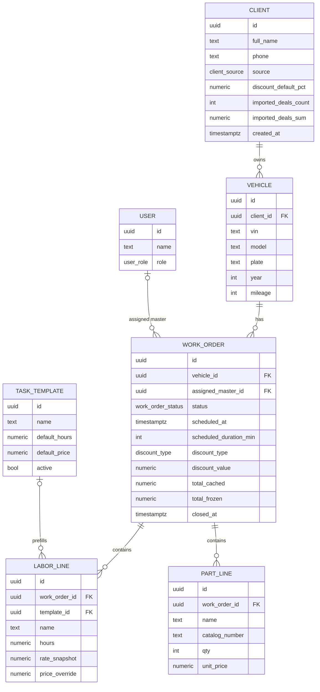

# Data Model: CRM для СТО (MINI Cooper)

Стек: **NestJS + PostgreSQL**. Минимальная схема, не загоняющая в угол при добавлении модулей (бот, документы, отчёты, каталог, доп. роли).

---

## Две опоры

- **Vehicle** (с VIN + историей работ) — центральный объект учёта, не клиент.
- **WorkOrder** (заказ-наряд / «работа») — главный транзакционный документ: планируется на календаре, двигается по канбану, считается в смете.

---

## ERD



```
Client 1──* Vehicle 1──* WorkOrder 1──* LaborLine ──? TaskTemplate
                                     └──* PartLine
                         WorkOrder ──? User (master)
```

---

## Сущности

### Client
Клиент. **Новое в v1.1:**
- `source` (`client_source`) — откуда пришёл: `manual` (по умолчанию), `telegram_bot` (под будущий бот), `csv_import` (при импорте).
- `imported_deals_count` / `imported_deals_sum` — исторические агрегаты из старой системы (через CSV). Заполняются только при импорте, по умолчанию 0.
- `created_at` — при импорте проставляется из CSV (а не `now()`), чтобы сохранить реальную дату регистрации.

> **Живые vs исторические агрегаты.** Закрытые сделки/выручка по работам внутри системы считаются из `work_orders` (status=`closed`, `total_frozen`). Полный lifetime клиента = `imported_*` (до системы) + посчитанное по нарядам (в системе). Это даст «топ клиентов по выручке» сразу после миграции.

> Расширение: отдельная `client_phones` для нескольких телефонов — позже; в MVP один телефон.

### Vehicle
ТС. Один клиент → много машин. `vin`/`plate` nullable. `model` = поколение MINI (R56, F56…). `mileage` — только текущий.

### WorkOrder
Заказ-наряд = одна единица работы по машине (один визит). Лежит на **календаре** (`scheduled_at`), двигается по **канбану** (`status`), считается в **смете** (строки − скидка). `assigned_master_id` nullable → второй мастер/загрузка без миграции.
- `total_cached` — пересчёт сервисом при изменении строк/скидки (для списков).
- `total_frozen` — фиксируется при закрытии (для отчётов/выручки).

### LaborLine
Операция. **Snapshot цены:** `rate_snapshot` копируется при добавлении; `price_override` перебивает расчёт. Итог = `price_override ?? hours × rate_snapshot`. Зачем — чтобы смена глобальной ставки не двигала прошлые наряды (AC-8).

### PartLine
**Только стоимость, не склад.** `name`, `catalog_number` (опц., задел под каталог), `qty`, `unit_price`. Остатки/поставщики — вне скоупа.

### TaskTemplate
Преднастроенные операции с фикс. часами/ценой. Подставляются в `LaborLine`.

### User
Аккаунты системы. **MVP — одна роль/один аккаунт**, но `users` + `role` + `assigned_master_id` заложены, чтобы добавить роли/мастеров без переделки.

### Settings
Глобальная ставка `labor_rate` (key-value или `service_rates` с датами под версионирование). В MVP — одно значение, копируется в `rate_snapshot`.

---

## Enums

```sql
CREATE TYPE work_order_status AS ENUM (
  'scheduled',    -- Запланирована
  'in_progress',  -- В работе
  'waiting',      -- Ожидание (запчасти/согласование)
  'done',         -- Готова
  'closed'        -- Выдана / Закрыта
);

CREATE TYPE discount_type AS ENUM ('percent', 'fixed');
CREATE TYPE user_role     AS ENUM ('owner');                          -- расширяемо: ALTER TYPE ... ADD VALUE 'master'
CREATE TYPE client_source AS ENUM ('manual', 'telegram_bot', 'csv_import');
```

---

## Schema sketch (Postgres DDL — черновик)

```sql
CREATE EXTENSION IF NOT EXISTS pg_trgm;

CREATE TABLE clients (
  id                   uuid PRIMARY KEY DEFAULT gen_random_uuid(),
  full_name            text NOT NULL,
  phone                text NOT NULL,
  source               client_source NOT NULL DEFAULT 'manual',
  discount_default_pct numeric(5,2),
  imported_deals_count int NOT NULL DEFAULT 0,        -- из CSV
  imported_deals_sum   numeric(14,2) NOT NULL DEFAULT 0, -- из CSV
  notes                text,
  created_at           timestamptz NOT NULL DEFAULT now(), -- при импорте берётся из CSV
  updated_at           timestamptz NOT NULL DEFAULT now()
);

CREATE TABLE vehicles (
  id         uuid PRIMARY KEY DEFAULT gen_random_uuid(),
  client_id  uuid NOT NULL REFERENCES clients(id) ON DELETE CASCADE,
  vin        text,
  model      text,                 -- R56 / F56 / ...
  plate      text,
  year       int,
  mileage    int,
  notes      text,
  created_at timestamptz NOT NULL DEFAULT now(),
  updated_at timestamptz NOT NULL DEFAULT now()
);

CREATE TABLE users (
  id   uuid PRIMARY KEY DEFAULT gen_random_uuid(),
  name text NOT NULL,
  role user_role NOT NULL DEFAULT 'owner'
  -- + поля auth (hash пароля и т.п.)
);

CREATE TABLE work_orders (
  id                     uuid PRIMARY KEY DEFAULT gen_random_uuid(),
  vehicle_id             uuid NOT NULL REFERENCES vehicles(id) ON DELETE RESTRICT,
  assigned_master_id     uuid REFERENCES users(id),
  status                 work_order_status NOT NULL DEFAULT 'scheduled',
  title                  text,
  scheduled_at           timestamptz,
  scheduled_duration_min int,
  discount_type          discount_type,
  discount_value         numeric(12,2),
  total_cached           numeric(12,2) NOT NULL DEFAULT 0,
  total_frozen           numeric(12,2),
  created_at             timestamptz NOT NULL DEFAULT now(),
  updated_at             timestamptz NOT NULL DEFAULT now(),
  closed_at              timestamptz
);

CREATE TABLE task_templates (
  id            uuid PRIMARY KEY DEFAULT gen_random_uuid(),
  name          text NOT NULL,
  default_hours numeric(6,2),
  default_price numeric(12,2),
  active        boolean NOT NULL DEFAULT true
);

CREATE TABLE labor_lines (
  id             uuid PRIMARY KEY DEFAULT gen_random_uuid(),
  work_order_id  uuid NOT NULL REFERENCES work_orders(id) ON DELETE CASCADE,
  template_id    uuid REFERENCES task_templates(id),
  name           text NOT NULL,
  hours          numeric(6,2),
  rate_snapshot  numeric(12,2) NOT NULL,
  price_override numeric(12,2)
);

CREATE TABLE part_lines (
  id             uuid PRIMARY KEY DEFAULT gen_random_uuid(),
  work_order_id  uuid NOT NULL REFERENCES work_orders(id) ON DELETE CASCADE,
  name           text NOT NULL,
  catalog_number text,
  qty            int NOT NULL DEFAULT 1,
  unit_price     numeric(12,2) NOT NULL
);

-- Индексы
CREATE INDEX idx_clients_name_trgm   ON clients USING gin (full_name gin_trgm_ops);
CREATE INDEX idx_clients_phone_trgm  ON clients USING gin (phone gin_trgm_ops);
CREATE INDEX idx_clients_source      ON clients(source);
CREATE INDEX idx_vehicles_vin_trgm   ON vehicles USING gin (vin gin_trgm_ops);
CREATE INDEX idx_vehicles_plate_trgm ON vehicles USING gin (plate gin_trgm_ops);
CREATE INDEX idx_vehicles_client     ON vehicles(client_id);
CREATE INDEX idx_wo_vehicle          ON work_orders(vehicle_id);
CREATE INDEX idx_wo_status           ON work_orders(status);          -- канбан
CREATE INDEX idx_wo_scheduled        ON work_orders(scheduled_at);    -- календарь
```

> Дедуп при импорте — по нормализованному телефону, в сервисе. Если хочется надёжнее на уровне БД: добавить generated-колонку `phone_normalized` + `UNIQUE` (опционально, не для MVP).

---

## CSV-импорт клиентов

**Формат (порядок колонок):** `ФИО, телефон, дата создания, кол-во закрытых сделок, сумма закрытых сделок`

| CSV | → поле | Примечание |
|---|---|---|
| ФИО | `full_name` | |
| телефон | `phone` | нормализуется (8→+7, убрать пробелы/скобки) |
| дата создания | `created_at` | парс `ДД.ММ.ГГГГ` или ISO |
| кол-во закрытых сделок | `imported_deals_count` | пусто → 0 |
| сумма закрытых сделок | `imported_deals_sum` | пусто → 0 |

При импорте: `source = csv_import`.

**Робастность (грабли русских CSV):**
- кодировка UTF-8 **и** CP1251 (Excel часто отдаёт CP1251)
- разделитель `,` **или** `;`
- заголовок опционален (маппинг по позиции)
- **дедуп по нормализованному телефону**: существующий — пропустить (или обновить агрегаты, по выбору), новый — вставить → повторный импорт не плодит дубли
- битые строки не валят весь импорт: отчёт «N добавлено, M пропущено, ошибки по строкам»

---

## Документы (вне MVP, но модель готова)

Рендер заказ-наряда/акта = `WorkOrder` + `Vehicle` + `Client` + строки (Handlebars/HTML→PDF). **Схема уже содержит все нужные данные** — будущий `DocumentsModule` подключается без миграции.

---

## Как ложатся фичи на модель (views, не таблицы)

- **Календарь** = `work_orders` где `scheduled_at` в диапазоне, опц. по мастеру.
- **Канбан** = `work_orders` по `status`; drag-drop = `PATCH /work-orders/:id { status }`.
- **Поиск** = `pg_trgm`/`ILIKE` по `full_name, phone, vin, plate`. На 300 записях мгновенно.
- **Смета** = Σ labor + Σ parts − скидка; в `WorkOrderService` (единый источник), кэш `total_cached`, заморозка `total_frozen` при закрытии.

---

## Hooks под масштаб (закладываем сейчас — почти бесплатно)

1. **Логика в сервисах** → бот и CSV-импорт вызывают `ClientsService`/`WorkOrderService`, не дублируют логику.
2. **Snapshot ставок/цен** → отчёты и выгрузка выручки исторически корректны.
3. **`assigned_master_id` + `user_role` enum** → роли/мастера/выработка без миграции.
4. **`source` на клиенте** → бот проставит `telegram_bot`, аналитика по каналам сразу разделяется.
5. **`imported_*` агрегаты** → lifetime клиента = история + живые наряды, для будущих отчётов.
6. **`catalog_number`** → будущий каталог/склад линкуется по номеру.

## Чего сознательно НЕ делаем

На ~300 клиентах и 1 мастере лишнее: Redis/BullMQ/очереди (документы синхронно), полнотекст/Elastic, микросервисы, учёт остатков. «Масштабируемость» = чистые границы + правильная модель, а не инфраструктура под нагрузку.
